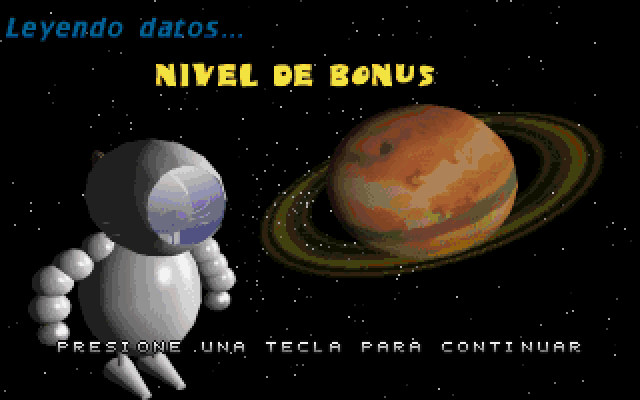
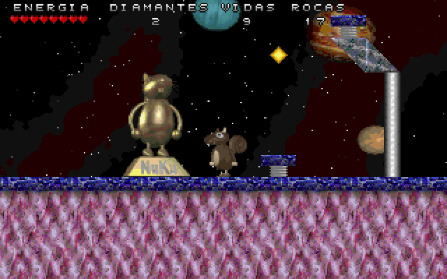
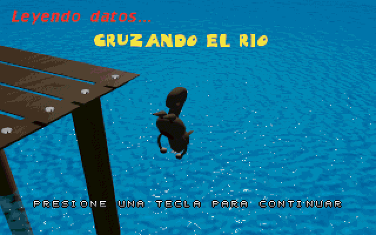
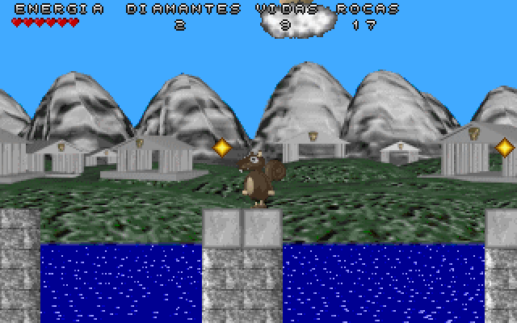
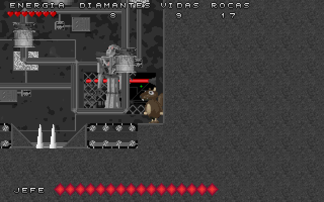

# Nuku

A game programmed in 1996 by Juan Linietsky and Pablo Selener in Borland Pascal for DOS.

This fork is based on [reduz/nuku](https://github.com/reduz/nuku), the 2019 port of the game
to SDL 1.2 that, as its README said, did not compile or work. Here it builds and runs.

## Screenshots

  
  
  

  
  
  

## Branches

| Branch | What it is |
|---|---|
| `master` | DOS build (VGA mode 13h, Sound Blaster/GUS/WSS) plus a Windows/Linux build with a few conveniences |
| `port2019` | The 2019 SDL port with only the changes needed to compile and run, for Windows x86/x64 and Linux |

Ready-made builds are in [Releases](../../releases).

## What was changed

Shared by both branches, in the game code (`nukunit`, `nukumain`, `nukusupl`):

- inline 16/32-bit assembly replaced with equivalent Pascal (tile and sprite blits, palette, RNG);
- the font buffer was 56 bytes too small for what the loader writes into it;
- level maps were read only partially (64000 of 65500 bytes), so ground was missing at the start of level 1;
- names adapted to the stock Free Pascal SDL 1.2 binding.

`master` additionally has:

- a DOS platform layer in `dos/`, written from scratch in the style of DOS games of the time:
  VGA mode 13h with the palette written to the DAC ports, an IRQ1 keyboard handler,
  a millisecond clock from the PIT, sound through libmikmod built with DJGPP;
- `dos/libmikmod-dos.patch`, fixes to libmikmod's DOS drivers (see `dos/BUILD.txt`);
- on Windows/Linux: integer window scaling (F9), fullscreen (F10, Alt+Enter), a log file
  instead of console output, and the Eagle filter ported from C to Pascal.

## Building

**DOS** (`master`): see [dos/BUILD.txt](dos/BUILD.txt). Needs a Free Pascal 3.2.2
cross compiler for go32v2, DJGPP and the patched libmikmod. To run it you need a DPMI host,
such as HDPMI32 from the [HX DOS Extender](https://github.com/Baron-von-Riedesel/HX) or CWSDPMI.

**Linux** (`master`): `./build.sh`, needs `fpc`, SDL 1.2 and libmikmod.

**Windows** (cross-compiled from Linux): `./build.sh win64` with a win64 Free Pascal RTL and SDL unit,
see the comments in `build.sh`. Put `SDL.dll` and `libmikmod-3.dll` next to the exe.

## Known issues

- DOS build: sound reportedly stops on the final boss level.
- The cheat that refilled energy (`key[$19]` in `nukunit.pas`, the P key in DOS) uses a DOS
  scancode, so it does not work with SDL key codes. Left as in the 2019 port.
- Esc during a level counts it as finished; to quit a level, pause with F11 and press Esc.

## License

The game is under the MIT license, see [LICENSE.md](LICENSE.md).
SDL 1.2 and libmikmod are under the LGPL; the libmikmod patch and build instructions are in `dos/`.

